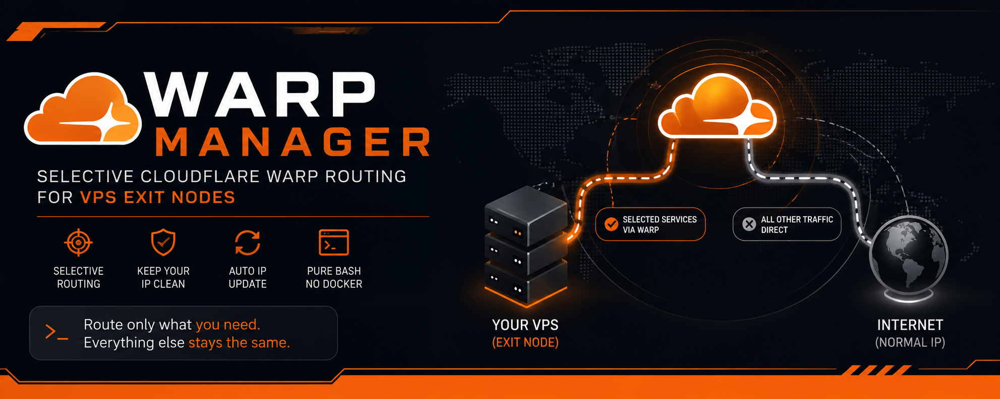

<p align="center">
  
</p>

# WARP Manager

**Selective Cloudflare WARP routing for Linux VPSs.**

<p align="center">

Route only the services you choose through Cloudflare WARP while everything else keeps your
server's public IP.

No Docker • Pure Bash • Zero changes to your tunnel or proxy configuration

</p>

Telegram: **@BlackProtocols**

---

## Install

Ubuntu / Debian:

```bash
sudo bash -c "$(curl -fsSL https://raw.githubusercontent.com/AminMGMT/WARP-Manager/main/setup.sh)"
```

The installer downloads everything, prepares WARP, and opens the menu when it is done.

<details>
<summary>Manual install</summary>

```bash
git clone https://github.com/AminMGMT/WARP-Manager.git
cd WARP-Manager
sudo bash install.sh
```

</details>

A small AI preset is enabled automatically, so ChatGPT, Gemini, Claude, Copilot, Grok and
Perplexity work immediately. Open the menu to change it:

```bash
sudo wm
```

---

## What it does

Sending *everything* through WARP fixes a blocked VPS but changes your exit IP for all
traffic. WARP Manager sends only the domains you pick.

It intercepts the server's outbound HTTP/HTTPS with **nftables TPROXY** and hands it to a
local **sing-box**, which reads the real destination from the TLS **SNI** and **QUIC
ClientHello** and decides per domain: selected services go out through Cloudflare WARP,
everything else through the server's normal interface.

```
Application
     │
     ▼
Is the destination selected?
     │
 ┌───┴──────────────┐
 ▼                  ▼
Yes                No
 │                  │
 ▼                  ▼
Cloudflare WARP   Direct Internet
```

Because the decision is made by domain and not by IP, applications keep working when their
backends or CDNs change. Your tunnel, proxy and panel are never modified — and if the engine
becomes unhealthy, a fail-open watchdog removes the redirect so traffic keeps flowing.

---

## Features

- **100+ built-in providers** across AI, streaming, social, gaming, developer and cloud —
  plus your own custom domains
- **Domain-based routing** via TLS SNI and QUIC ClientHello, with full HTTP/3 support
- **Works with any stack** — Xray, Marzban, Marznode, Hiddify, OpenVPN, WireGuard, Outline
- **Ad blocker** built on uBlock Origin's filter lists, with no DNS server or extra service
- **Automatic IP health monitoring**, scheduled restarts and route refresh
- **Presets** to clone a whole configuration onto another server in seconds
- **WARP+ license** support
- **Fail-open protection** — a broken engine can never take your tunnel down
- Pure Bash, no Docker, no DNS hijacking, no public listening ports

---

## Documentation

| | |
|---|---|
| [How It Works](docs/how-it-works.md) | Architecture, the two interception paths, tunnel safety, design goals |
| [Menu Reference](docs/menu.md) | Every screen and setting, plus the command-line flags |
| [Providers](docs/providers.md) | The full catalogue and how to add your own |
| [Ad Blocker](docs/ad-blocker.md) | What it blocks, what it cannot, and why it is safe |
| [Troubleshooting](docs/troubleshooting.md) | Diagnose, rate limits, updates, uninstall |

Not routing what you expected? Start with:

```bash
sudo warp-manager --diagnose
```

---

## Acknowledgements

WARP account registration is powered by [wgcf](https://github.com/ViRb3/wgcf).
Special thanks to [ClassicDarkPack](https://github.com/ClassicDarkPack) for helping compile
and maintain the YouTube advertising domain lists used by the Ad Blocker.

## Support

If WARP Manager helps you, a star or a small tip is appreciated. 🙏

Telegram channel: **@BlackProtocols**

| Coin | Address |
|------|---------|
| Tron (TRX) | `TTzuUAtsEsrLgNpFVLNTyLVJVRRFNWESYc` |
| USDT (BEP20) | `0xc112AE9bfF7c59dEcFb34E988A397848D3093E82` |
| Toncoin (TON) | `UQD9g40QubAICJ6zPqegtCY7s-joMx2DB8aIqA0xF1aHoCDs` |

## License

Copyright © 2026 Amin Mohammadi (AminMGMT). Released under the MIT License — see
[LICENSE](LICENSE) and [NOTICE](NOTICE).
